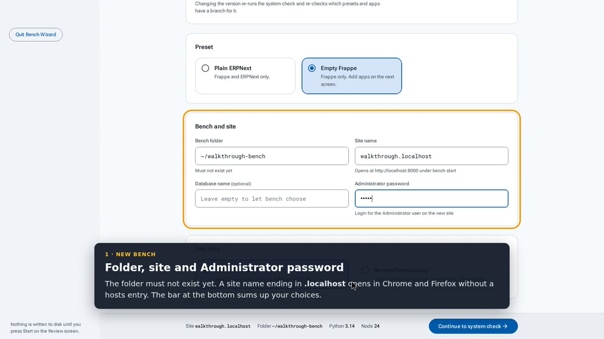
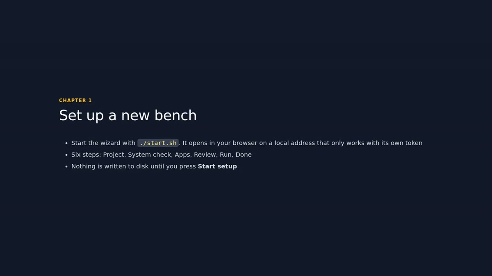
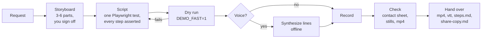
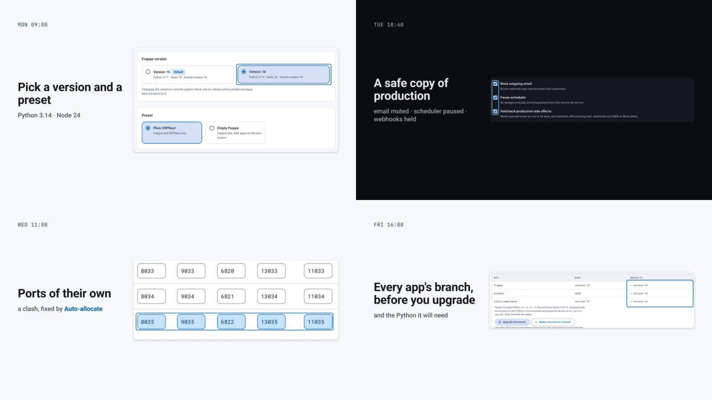
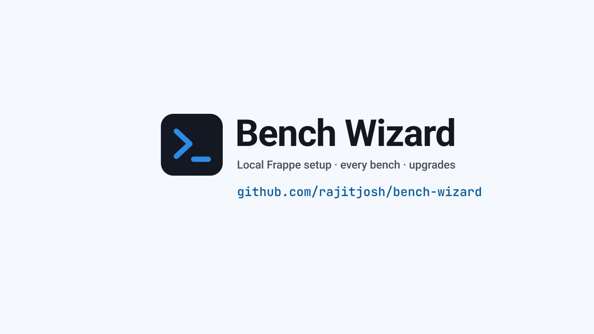
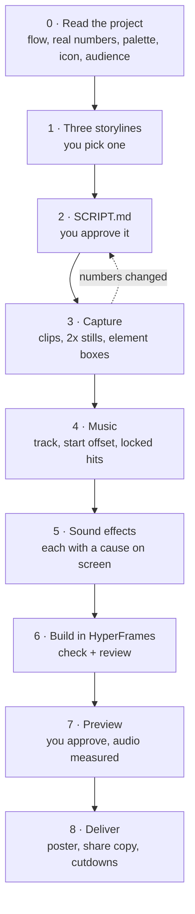

# claude-skills

Skills for [Claude Code](https://claude.com/claude-code) (and other agents that read `SKILL.md` skills) from work on
Frappe/ERPNext apps: dashboards, upgrades, and walkthrough and promo videos of any web app.

| Skill | Use it for |
|---|---|
| [`recording-walkthrough-videos`](#recording-walkthrough-videos) | A captioned (optionally voiced) walkthrough video of a web app flow, scripted as a Playwright test so a broken flow fails the run: mp4 with chapters and a poster, subtitles, step-by-step stills and `steps.md` for setup docs, and share copy. Notes for Frappe desk and Vuetify apps. |
| [`making-product-promo-videos`](#making-product-promo-videos) | A 30-90 s promo film of the real product, built in HyperFrames from clean Playwright captures: the script approved first, crops and highlights from the page's real boxes, music picked and synced by measurement, every number from a recorded run, delivered with a poster, share copy and cutdowns. |
| [`frappe-premium-dashboard`](#frappe-premium-dashboard) | A polished, animated dashboard inside a Frappe/ERPNext custom app, not a stock Workspace: the delivery route (Vue 3 with frappe-ui, a Desk page or a web page), a permission-checked and cached data layer, layout, design tokens, charts, and motion that respects reduced-motion. |
| [`frappe-upgrade-impact`](https://github.com/rajitjosh/bench-wizard/tree/main/bench_wizard/claude-plugin) | What a Frappe/ERPNext custom app must change for a new Frappe version, with a scanner for core APIs, overrides, fields and the known breaking changes. It lives in [Bench Wizard](https://github.com/rajitjosh/bench-wizard), which runs it from its Upgrade page; this marketplace lists it from there. |

## Install

In Claude Code:

```
/plugin marketplace add rajitjosh/claude-skills
/plugin install rajitjosh-skills@rajitjosh
/plugin install bench-wizard-frappe@rajitjosh
```

With the [`skills`](https://github.com/vercel-labs/skills) installer, for Claude Code, Codex, Cursor and others:

```
npx skills add rajitjosh/claude-skills
```

Or copy a folder from `skills/` into `~/.claude/skills/`.

A skill loads by itself when your request matches it ("make a walkthrough video of …"), or by name:
`/recording-walkthrough-videos`.

---

## recording-walkthrough-videos

A step-by-step video of a real flow in your app, with a caption for every step. The flow is a Playwright test: every
step is asserted, so a broken flow fails the run instead of shipping a misleading video.


*The field being explained is outlined (`spot()`), and the caption moves out of its way by itself.*


*Each part opens with a chapter card; each card becomes a chapter of the mp4.*

### What you get

```
out/<flow>-2026-11-20-1430/
  <flow>.mp4               the video: H.264, plays everywhere, chapters embedded, the poster as frame 0
  <flow>.jpg               the poster (the thumbnail chat apps show)
  <flow>.vtt               subtitles matching the captions
  <flow>.chapters.vtt      chapters for web players
  youtube-chapters.txt     "0:00 Set up a new bench" lines to paste under a link
  steps.md                 every step: heading, text, timestamp, still (the start of a setup doc)
  stills/01.png …          one screenshot per step, without its caption
  contact-sheet.png        one frame every 5 s, to check the whole video at a glance
  share-copy.md            a chat post and an email version, written by the agent
```

### What you need

- The app running on a **dev or staging** site (never production: the recording writes real records), and a seeded
  demo login.
- Node 22 or newer (`nvm use 24`), Playwright 1.65 or newer (for the animated cursor and click highlight), and system
  `ffmpeg` with `ffprobe`.
- For a voiceover, a one-time offline setup of Kokoro (see the header of
  [`voice.py`](skills/recording-walkthrough-videos/voice.py)).

### How to ask

Write a sentence ("make a video of how HR raises OT on staging"), or fill in the request; the agent asks only for what
is missing and offers every choice you didn't make, with a recommendation:

```
Walkthrough video: OT calculation on Payroll Entry
Who will see it: internal only
Site: https://staging.example.com
Login: use out/.auth.json (demo user hr.demo)
Audience: end users
Flows: open OT Calculation for one employee; update the hours; create salary slips
Layout: panel
Pace: relaxed
Voiceover: yes, voice af_heart
Extras: Word doc from the steps
```

"Who will see it" matters: lists, logs and file names on screen show real names. For a public video the agent runs an
app instance that sees only demo data.

### What happens



Every dry run repeats the flow's writes (backups, records), so the agent says what each run adds and iterates on one
part at a time.

### Commands

The agent runs these; they are here so you can re-record yourself.

```bash
# dry run: every hold 300 ms, no slow motion: selector and data failures show in seconds
DEMO_FAST=1 npx playwright test -c <dir>/demo.config.ts

# record
DEMO_LAYOUT=overlay DEMO_PACE=1 npx playwright test -c <dir>/demo.config.ts

# one part only, while fixing it
DEMO_FROM=3 DEMO_STOP=3 DEMO_FAST=1 npx playwright test -c <dir>/demo.config.ts
```

| Setting | Values |
|---|---|
| `DEMO_LAYOUT` | `overlay` (default): the app full screen, a caption box placed automatically · `panel`: 1920x1080, the app at full size beside a text column that never covers it |
| `DEMO_PACE` | `0.7` brisk · `1` normal · `1.4` relaxed (scales clicks and caption holds together) |
| `DEMO_VOICE` | `af_heart` (default voice), `am_michael`, `bf_emma` · leave unset for no voice |

### The script, in short

```ts
const demo = await Demo.start(page, context, "out/ot-2026-11-20-1430"); // first, before login and seeding
// …log in and seed through the API…
await demo.open("/app/payroll-entry");
const app = demo.app;                 // every locator goes through this, so both layouts work
demo.begin();                         // the mp4, subtitles and steps.md start here

if (runPart(1)) {
  await demo.card("Part 1", "Open OT Calculation", ["Done once a month by HR"]);
  await app.getByRole("button", { name: "OT Calculation" }).click();
  await expect(app.getByText("Employee")).toBeVisible();
  await spot(app.locator('[data-fieldname="employee"]'));
  await demo.say("Part 1", "Pick the employee", "Only employees with OT this month are listed.");
  await spot(app.locator('[data-fieldname="employee"]'), false);
  await demo.poster();                // the thumbnail: the strongest settled screen
}
await demo.finish("ot");
```

[`kit-selftest.demo.ts`](skills/recording-walkthrough-videos/kit-selftest.demo.ts) tests the kit (30 tests); the skill
also carries notes for [Frappe desk](skills/recording-walkthrough-videos/frappe.md) and
[Vuetify apps](skills/recording-walkthrough-videos/vuetify.md).

### Sharing

Over 25 MB in total, or for an email list, share Drive links rather than attachments, restricted to your domain when the
screens show client data. Drive and browsers ignore embedded chapters, so paste `youtube-chapters.txt` under the link.

---

## making-product-promo-videos

A short film of the real product: real screens, real numbers from a recorded run, cut to music. The script is the
contract, approved before anything is captured or built.


*Four beats of one film. The label column on the left says what happened; the ring marks the one result, placed from
the element's real box on the page.*


*The end card: the product's own icon, its name and the link.*

### What you get

```
renders/<name>-2026-11-20-1700/
  film.mp4          1920x1080, music and sound, the poster as frame 0
  film.jpg          the poster
  share-copy.md     a chat post and an email version, with the real numbers
  film-vertical.mp4 optional 15-20 s cutdowns for social (1080x1920 or 1080x1080), each with its poster
```

### What you need

- The app running on a dev or staging site, with demo data that has clean names (no "test" anywhere on screen).
- [HyperFrames](https://github.com/heygen-com/hyperframes) (`npx hyperframes auth login`, free) and the `heygen` CLI
  for the music catalog. Node 22 or newer, Playwright 1.65 or newer, system `ffmpeg`.

### How to ask

```
Make a 60-second promo video of <product> from its real screens.
App runs at <dev URL>. Audience: <who>. End card link: <link>.
```

### What happens

Every step ends with a gate; the next step doesn't start until it holds.



What keeps it honest and readable:

- **Real screens and numbers.** Every number on screen comes from the recorded run. Numbers in the script are
  placeholders until the capture, and the agent tells you when the real ones differ.
- **Highlights from the page, never by eye.** The capture records each component's real box with the still:

  ```ts
  await clip.shot("upgrade-table", {
    crop: page.locator(".upgrade-card table"),     // what the panel shows
    ring: page.locator("td.moves-to"),             // the one result to ring
  });
  ```

- **Music by measurement.** Candidates from the catalog, then `hyperframes beats` and `hyperframes audio`: bars that
  divide the 5-6 s feature beats, a start offset that lands the strongest hits on the reveal and the payoff (within
  ±0.15 s), the tail after the end card.
- **Reading over motion.** Text never snaps to every beat, zooms never push context out of frame, and reading shots
  hold still.

[`kit-selftest.capture.ts`](skills/making-product-promo-videos/kit-selftest.capture.ts) tests the capture kit.

---

## frappe-premium-dashboard

A dashboard inside a Frappe/ERPNext custom app that looks and moves like a modern SaaS product: a hero, rolling-digit
KPIs, a card grid and custom charts. Stock Workspaces, Number Cards and Dashboard Charts can't produce this, so it
builds a custom page in your custom app and never touches core files.

### How to ask

```
Build a sales dashboard in <custom app> with 4-6 KPIs per tab (orders, revenue, top customers),
filters by company and date, for the Sales Manager role.
```

### What happens

1. **Pick the delivery route** (the agent asks if unclear):

   | Route | When |
   |---|---|
   | A. Vue 3 SPA with frappe-ui (default) | A full-screen app feel, tabs, rich interaction and motion |
   | B. Desk Page | It must live inside `/app` with the navbar |
   | C. Web page (`www/`) | Read-only, shareable with portal users |

2. **Data layer first:** whitelisted API methods with permission checks, tested with `bench execute`.
3. **Components, then tabs:** rolling KPI digits, chart cards, ranked bars, filters, detail panel, skeletons, wired to
   shared filter state.
4. **Motion last**, with a reduced-motion path; checked at desktop and 375 px width, as a restricted user, at 60 fps.

You get the file tree of changes, the API module, the components and CSS tokens, the `hooks.py` entries and a short
README (route, roles, how to add a card, how to tune motion).

---

## License

[MIT](LICENSE)
